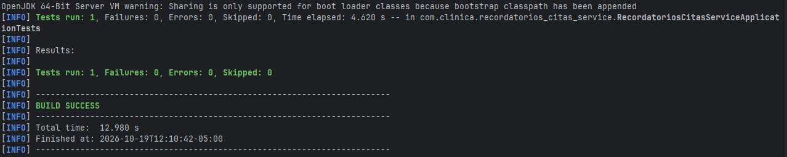
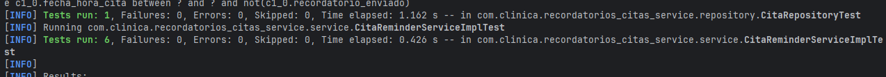
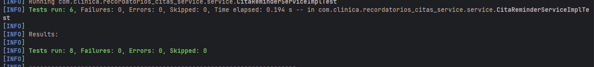

# Recordatorios Citas Service

!

## Descripción
Repositorio del post-contenido de la Unidad 9 de Patrones de Diseño
de Software — Sexto Semestre. Un único proyecto Spring Boot que
envía recordatorios de citas por el canal preferido del paciente,
construido desde el inicio con Strategy (ReminderChannel) y Factory
Method (ReminderChannelFactory) inyectados por constructor.

## Parte 1 — Pruebas Unitarias con JUnit 5 y Mockito
`CitaReminderServiceImplTest` aísla `CitaReminderServiceImpl` de sus
colaboradores. Ver "Decisiones de diseño" para el mapeo entre patrones y
pruebas.

**Mock vs. Stub vs. Fake (Parte 1).** Para cada colaborador del constructor
de CitaReminderServiceImpl se tomó una decisión distinta:

- **CitaRepository → Mock.** No basta con stubbear
  findByFechaHoraCitaBetweenAndRecordatorioEnviadoFalse para que devuelva
  una lista: también hay que verificar que save() se llama exactamente una
  vez y con la cita ya marcada como enviada. Cuando una prueba necesita
  controlar la respuesta y además verificar la interacción, el doble es un
  Mock y no un simple Stub.

- **ReminderChannelFactory y ReminderChannel → Mock.** El comportamiento
  bajo prueba es la selección de la estrategia: que el servicio pida el
  canal EMAIL (o SMS) según la preferencia del paciente y que ese canal
  reciba el mensaje. Eso solo se comprueba verificando la interacción
  (verify(factory).obtenerCanal(...) y verify(canal).enviar(...)), no con
  un valor de retorno.

- **Clock → Fake (Clock.fixed).** El JDK ya provee una implementación real
  y completa de Clock que se comporta igual que en producción, solo que con
  el instante congelado. Mockearlo exigiría stubbear instant() y getZone()
  por separado y correría el riesgo de que LocalDateTime.now(clock) no se
  comporte como con un Clock real. Con el Fake, la ventana de 24 horas es
  exacta y reproducible en cualquier máquina y a cualquier hora; con
  Clock.systemDefaultZone() la aserción cambiaría en cada ejecución.

### Evidencia de pruebas — Parte 1


## Parte 2 — Refactor DIP, Integración y CI/CD
`enviarRecordatorioUrgente` nació con un `new` hardcodeado que lo hacía
imposible de testear; el refactor movió la construcción a
`config/CanalUrgenteConfig.java` e inyectó la abstracción por constructor.
`CitaRepositoryTest` (`@DataJpaTest`) y `CitaReminderServiceIntegrationTest`
(`@SpringBootTest`) prueban la persistencia y el flujo completo con H2 y un
Clock fijo. El pipeline `.github/workflows/ci.yml` ejecuta `mvn verify` en
cada push.

### Diagnóstico: por qué enviarRecordatorioUrgente no se puede testear

**Línea responsable:**
`ReminderChannel canalUrgente = new SmsReminderChannel(new TwilioNotificadorSmsGateway());`

El método construye con `new` el canal y el gateway dentro de su propio
cuerpo. Eso significa que la clase decide por sí misma cuáles
implementaciones concretas usa, en lugar de recibirlas desde afuera. En una
prueba unitaria no hay ningún punto donde reemplazarlas por un mock, así que
no se puede simular que el gateway falle ni verificar que, en ese caso, la
cita no se marca como enviada.

**Contraste:** enviarRecordatoriosPendientes() sí fue testeable desde la
Parte 1 porque su colaborador (ReminderChannelFactory) llega por
constructor. Los tests le entregaron un mock y controlaron todo lo que el
método hace con él.

Mockito.mockConstruction() permitiría interceptar ese `new`, pero sería
tratar el síntoma con una herramienta más potente. El problema es de diseño
y se resuelve con DIP.

### El refactor DIP

Para arreglar el problema no eliminé el `new`, porque alguien tiene que
construir el canal concreto en algún lugar. Lo que hice fue sacarlo del
método de negocio y llevarlo a `config/CanalUrgenteConfig.java`, que es el
composition root, donde sí tiene sentido construir objetos. Desde ahí
Spring registra un bean `canalUrgente` de tipo `ReminderChannel`, y el
servicio lo recibe por constructor igual que el repositorio, la factory y
el reloj.

**Antes (Paso 7):**

```java
@Override
public void enviarRecordatorioUrgente(Long citaId) {
    Cita cita = citaRepository.findById(citaId)
        .orElseThrow(() -> new CitaNoEncontradaException(citaId));

    ReminderChannel canalUrgente = new SmsReminderChannel(new TwilioNotificadorSmsGateway());
    canalUrgente.enviar(cita, "URGENTE: su cita es en menos de 2 horas y no ha sido confirmada");

    cita.setRecordatorioEnviado(true);
    citaRepository.save(cita);
}
```

**Después (Paso 8):**

```java
// CanalUrgenteConfig: el único "new" de este canal
@Bean
public ReminderChannel canalUrgente(NotificadorSmsGateway gateway) {
    return new SmsReminderChannel(gateway);
}

// CitaReminderServiceImpl: ya no construye nada
@Override
public void enviarRecordatorioUrgente(Long citaId) {
    Cita cita = citaRepository.findById(citaId)
        .orElseThrow(() -> new CitaNoEncontradaException(citaId));

    canalUrgente.enviar(cita, "URGENTE: su cita es en menos de 2 horas y no ha sido confirmada");
    cita.setRecordatorioEnviado(true);
    citaRepository.save(cita);
}
```

El comportamiento visto desde afuera es el mismo, pero ahora el servicio
depende de la abstracción `ReminderChannel` y ya no de `SmsReminderChannel`
ni de `TwilioNotificadorSmsGateway`. En `CitaReminderServiceImpl` no queda
ningún `new` de esas clases.

**Qué ganó la prueba.** Con el canal entrando por constructor, en el test
puedo pasarle un `@Mock ReminderChannel` y hacer que falle. Así escribí
`enviarRecordatorioUrgente_gatewayFalla_noMarcaComoEnviado`, que comprueba
que si el envío lanza una excepción, la cita no queda marcada como enviada
y no se guarda. Antes del refactor esa prueba no se podía escribir. Para mí
esa prueba es la evidencia de que la testabilidad es consecuencia directa
de aplicar DIP: no cambié la herramienta de pruebas, cambié el diseño.

### Pruebas de persistencia con @DataJpaTest

Hasta ahora todas las pruebas usaban mocks, así que el método
`findByFechaHoraCitaBetweenAndRecordatorioEnviadoFalse` nunca se había
ejecutado contra una base de datos. Como es un método derivado de Spring
Data (la consulta se genera a partir del nombre), un mock no demuestra que
el nombre esté bien escrito ni que la consulta filtre lo que debe.

Para comprobarlo creé `CitaRepositoryTest` con `@DataJpaTest`, que levanta
solo la capa de persistencia con una base H2 en memoria y no necesita
configuración adicional. La prueba guarda tres citas: una pendiente dentro
de la ventana, una dentro de la ventana pero ya enviada, y una fuera de la
ventana. Al consultar, el resultado debe ser exactamente una cita, la
pendiente. Eso confirma que la consulta aplica a la vez el filtro de fechas
y el de `recordatorioEnviado = false`.

Esta prueba complementa a las unitarias: Mockito comprueba que el servicio
llama al repositorio de forma correcta, y `@DataJpaTest` comprueba que el
repositorio responde de forma correcta.

**Evidencia — pruebas de persistencia**



### Prueba de integración con @SpringBootTest

`CitaReminderServiceIntegrationTest` levanta el contexto completo de
Spring, con repositorio, servicio, factory y canales reales, y solo
reemplaza dos cosas: el `Clock` y el gateway de SMS.

- **Clock fijo.** Registré un `Clock.fixed(...)` como bean `@Primary` en una
  `@TestConfiguration`. Así la ventana de 24 horas es la misma en cualquier
  máquina y a cualquier hora. Le puse un nombre distinto al bean de
  `ClockConfig` (`clockFijo` en lugar de `clock`) porque Spring Boot no
  permite sobrescribir un bean con el mismo nombre.
- **Gateway mockeado.** Con `@MockBean` sobre `NotificadorSmsGateway`
  reemplazo al proveedor de SMS, de modo que la prueba no depende de red ni
  de credenciales.

La prueba guarda una cita SMS dentro de la ventana, llama a
`enviarRecordatoriosPendientes()` y comprueba tres cosas: que devuelve 1,
que el gateway recibió exactamente un envío y que la cita quedó marcada
como enviada en la base de datos.

**Por qué H2 real pero gateway mockeado.** Parece incoherente mezclar una
base de datos real con un mock en la misma prueba, pero la razón es la
misma que en la Parte 1: se usa un doble cuando no existe una alternativa
real, simple y determinista. H2 cumple ese papel como Fake de la base
de datos, porque su contrato SQL/JPA equivale al de una base real y no
requiere infraestructura. Un proveedor de SMS de terceros no tiene un
equivalente gratuito y determinista, así que lo reemplazo con un Mock para
no depender de red, credenciales ni disponibilidad del proveedor, algo
crítico cuando la prueba corre en el pipeline de CI.

**Qué aporta Strategy + Factory aquí.** Gracias a que el gateway está
detrás de la interfaz `NotificadorSmsGateway`, bastó un solo `@MockBean`
para aislar toda la salida de SMS. Sin esa interfaz, la prueba de
integración tendría que haber interceptado un cliente HTTP concreto.

**Evidencia — prueba de integración**


### Integración continua con GitHub Actions

El workflow `.github/workflows/ci.yml` se ejecuta en cada push y en cada
pull request a `main`. Hace checkout del código, instala JDK 21 (Temurin)
con caché de dependencias de Maven y corre `mvn verify`, que compila el
proyecto y ejecuta todas las pruebas: las unitarias con Mockito, la de
persistencia con `@DataJpaTest` y la de integración con `@SpringBootTest`.

El workflow no declara ningún servicio de base de datos. Eso es posible
porque las pruebas de integración usan H2 en memoria. Si hubiera elegido
PostgreSQL con Testcontainers, el runner necesitaría Docker y los tiempos
de arranque serían mayores. La decisión de usar H2 simplifica directamente
la configuración del pipeline.

**Evidencia — pipeline en verde**



## Decisiones de diseño

**Por qué Strategy facilitó las pruebas.** Sin `ReminderChannel` como
interfaz, la lógica de envío (SMTP o SMS) estaría escrita en línea
dentro del servicio, y probar la selección de canal exigiría mockear
librerías de bajo nivel (cliente SMTP, cliente HTTP) en vez de una
sola interfaz propia con un método `enviar()`. Con Strategy, un solo
`@Mock ReminderChannel` basta para verificar cualquier canal.

**Por qué Factory facilitó las pruebas.** Sin
`ReminderChannelFactory`, el servicio tendría un if/else o un switch
embebido decidiendo el canal, y esa decisión solo sería observable
indirectamente (revisando qué se imprimió o qué se envió realmente).
Con la Factory inyectada, la selección de canal se verifica como una
interacción explícita: `verify(reminderChannelFactory).obtenerCanal(EMAIL)`.

**Por qué DIP facilitó las pruebas.** Inyectar por constructor el
repositorio, la factory, el canal urgente y el `Clock` es lo que permite
sustituir cada uno por un doble. El caso de `enviarRecordatorioUrgente`
muestra la diferencia: con `new` dentro del método no había dónde insertar
un doble; con el canal inyectado, el fallo del gateway se puede simular.

**Mapeo patrón → prueba**

| Patrón / principio | Prueba que facilitó | Sin el patrón sería más difícil porque... |
|---|---|---|
| Strategy (`ReminderChannel`) | `enviarRecordatoriosPendientes_citaEnVentana_usaElCanalPreferido`, `enviarRecordatoriosPendientes_citaSms_pideElCanalSms` | habría que mockear clientes SMTP/HTTP de bajo nivel en lugar de una interfaz con un método |
| Factory Method (`ReminderChannelFactory`) | `enviarRecordatoriosPendientes_citaSms_pideElCanalSms`, `enviarRecordatoriosPendientes_sinCitasPendientes_noConsultaLaFactory` | la selección de canal estaría embebida en un if/switch y solo sería observable de forma indirecta |
| DIP + `Clock` inyectado | `enviarRecordatoriosPendientes_ventanaDeterministaSegunClockFijo_consultaLosLimitesExactos` | `LocalDateTime.now()` haría la ventana de 24 horas distinta en cada ejecución |
| DIP en el canal urgente | `enviarRecordatorioUrgente_gatewayFalla_noMarcaComoEnviado` | el `new` interno impedía sustituir el canal por un mock que falle |
| Gateway detrás de interfaz (`NotificadorSmsGateway`) | `CitaReminderServiceIntegrationTest` | habría que interceptar un cliente HTTP concreto para no llamar a un proveedor real |

## Ejecutar las pruebas
```bash
mvn test      # Ejecuta todas las pruebas (unitarias, persistencia e integración)
mvn verify    # Lo mismo, dentro del ciclo completo de Maven (es lo que corre el CI)
```

## Herramientas utilizadas
- Java 21, Spring Boot 3.3, Spring Data JPA, H2, JUnit 5, Mockito
- Apache Maven, GitHub Actions, Git, GitHub

## Conclusiones
Con este proyecto vi que la facilidad para probar un servicio depende más
del diseño que de la herramienta de pruebas. Strategy y Factory Method
convirtieron la selección y el envío por canal en interacciones que un mock
puede verificar, y la inyección por constructor (DIP) fue lo que permitió
sustituir cada colaborador. El caso de `enviarRecordatorioUrgente` lo
confirmó: una prueba imposible de escribir pasó a ser posible con solo mover
un `new` al composition root. También aprendí a elegir el doble según el
caso (Mock cuando importa la interacción, Fake cuando el JDK o H2 ya ofrecen
una implementación real) y a combinar pruebas unitarias, de persistencia y de
integración en un pipeline de CI que corre sin infraestructura externa.